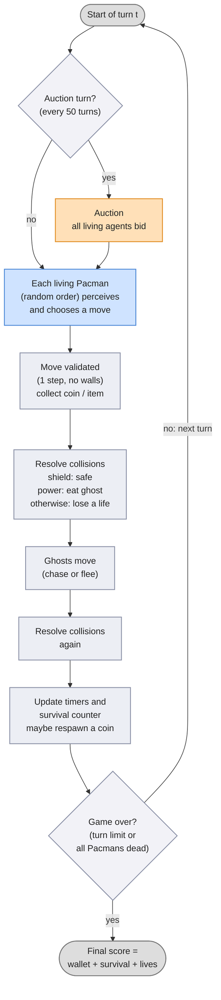
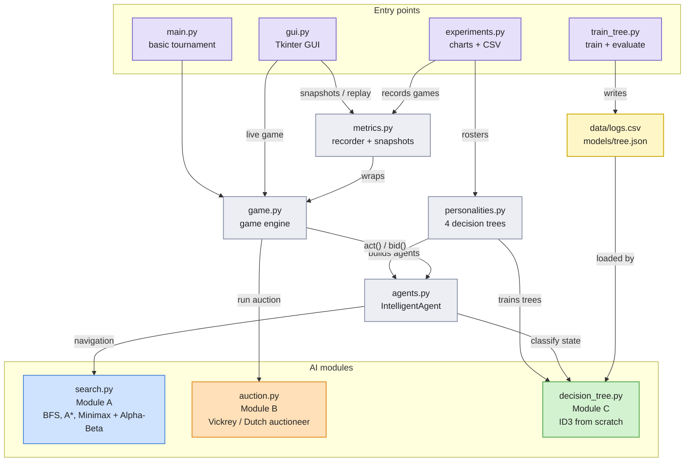
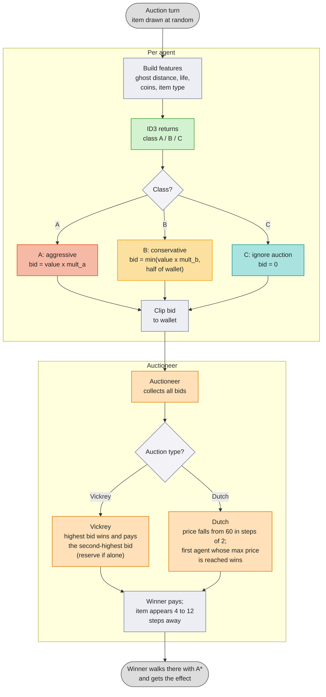
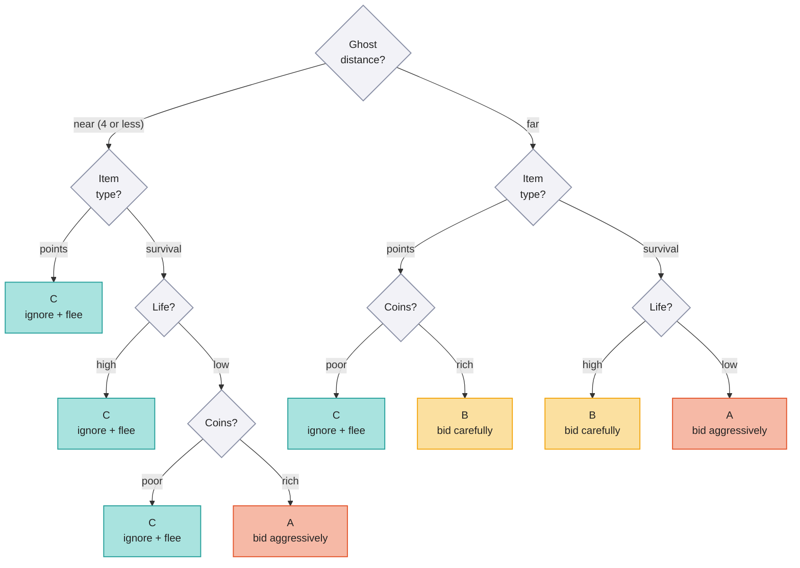
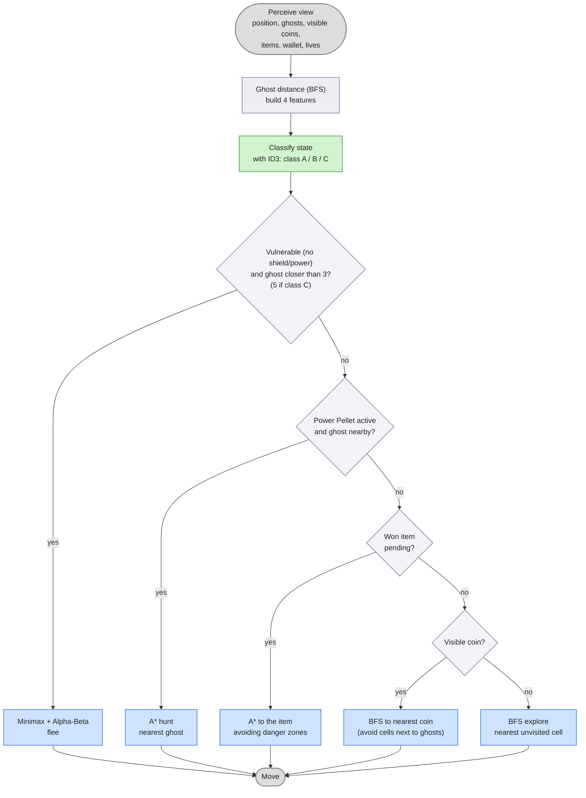
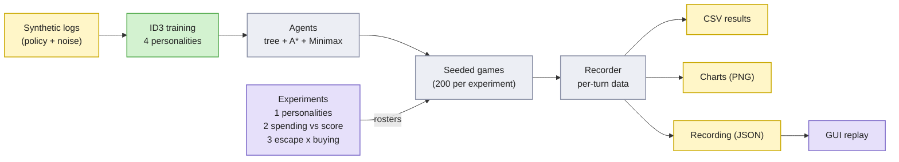

# Competitive Multi-Agent Pacman: Search, Auctions and Decision Trees

A multi-agent AI project in which several Pacman agents share one maze, flee from ghosts, collect coins and **compete for scarce resources sold at auction**. Each agent combines three classic AI techniques:

| Module | Topic | Role in the agent |
|---|---|---|
| **A** | Search and adversarial search (BFS, A\*, Minimax with Alpha-Beta pruning) | Low-level navigation and immediate survival |
| **B** | Auctions and resource allocation (Vickrey and Dutch) | Competitive economy and budget management |
| **C** | Decision trees (ID3, implemented from scratch) | High-level decision-making: when and how to bid |

The project is written in pure Python 3.10+. Only the optional parts need extra packages (`matplotlib` for charts, `tkinter` for the GUI).

> **Diagrams.** The figures below are written in [Mermaid](https://mermaid.js.org), which GitHub, GitLab, VS Code, Typora and PyCharm (Markdown preview) render automatically. PNG and SVG copies for slides or reports are in the `diagrams/` folder.

---

## 1. Game concept

Up to four Pacmans play in the same 21×11 maze together with three ghosts. The coins they collect are their **capital**. Special resources are not lying around in the maze. They are **sold at auction every 50 turns**:

| Item | Category | Base value | Effect |
|---|---|---|---|
| Power Pellet | Points | 25 | 25 turns in which the agent can eat ghosts (+20 coins each) |
| Extra Life | Survival | 30 | +1 life |
| Shield | Survival | 18 | 20 turns of immunity to ghosts |
| Radar | Points | 10 | 40 turns of full map knowledge |

Without a radar, an agent only sees coins within a radius of 5 cells. Ghosts are always visible.

**Winning an item is not enough.** The item appears at a random location in the maze (4 to 12 steps away), and only the winner can pick it up, so the agent has to navigate there.

**Final score** = remaining wallet + 0.3 points per turn survived + 10 points per remaining life.

This creates the central tension of the project: spending coins on survival tools now versus keeping them for the final score.

### Ghost behaviour

- With probability 0.7 a ghost chases the nearest Pacman that has no active Power Pellet. Otherwise it moves randomly.
- Ghosts flee from a Pacman with an active Power Pellet that is within 4 cells.
- A newly spawned or respawned Pacman has 3 turns of grace shielding.
- Coins respawn at random with probability 0.25 per turn, so the economy never dries up.

### Turn loop

Every turn of the engine follows the same sequence.



*Figure 1. Game turn loop.* (image version: `diagrams/01_turn_loop.png`)

---

## 2. Architecture

```
pacman_mad/
├── search.py          Module A: BFS, A*, Minimax + Alpha-Beta
├── auction.py         Module B: Vickrey and Dutch auctioneer, item catalogue
├── decision_tree.py   Module C: ID3 from scratch, log generation, persistence
├── agents.py          IntelligentAgent (integrates A + B + C), random agent
├── game.py            Game engine: maze, ghosts, items, auctions, scoring
├── personalities.py   Four decision-tree "personalities"
├── metrics.py         Game recorder, JSON snapshots, Pearson correlation
├── experiments.py     Three experiments + charts + CSV export
├── gui.py             Tkinter GUI with live auction and decision-tree panel
├── main.py            Basic tournament and ASCII rendering
├── train_tree.py      Trains and evaluates the base decision tree
└── tests/             142 unit tests (unittest)
```



*Figure 2. System architecture: entry points, core files and the three AI modules.* (image version: `diagrams/02_architecture.png`)

### Module A: navigation and search (`search.py`)

- **BFS** finds the nearest coin or the nearest unexplored cell, optionally avoiding cells next to ghosts.
- **A\*** (Manhattan heuristic) walks to won items. A danger map adds extra cost to cells near ghosts, so paths take detours around threats.
- **Minimax with Alpha-Beta pruning** handles escape. Pacman is the MAX player and the nearest ghosts are adversarial MIN players. The evaluation function rewards distance from ghosts and open escape routes. It also gives a small pull towards the current goal, which only matters when ghosts are far away.

### Module B: auctions (`auction.py`)

An `Auctioneer` collects one sealed bid per agent and decides the winner and the price:

- **Vickrey (second price):** the highest bid wins and pays the second-highest bid. With a single bidder the price is the reserve price.
- **Dutch:** the price starts high and descends. The first agent whose maximum price is reached wins and pays the current price.

Ties are broken randomly. Bids are always clipped to the bidder's wallet, so a wallet can never go negative.

#### Auction flow

From the agent's bid to the winner picking up the item:



*Figure 3. How an auction is resolved.* (image version: `diagrams/03_auction_flow.png`)

### Module C: decision tree (`decision_tree.py`)

A hand-written **ID3** classifier (entropy and information gain, categorical features, optional depth limit, JSON save/load). It classifies the game state using four features:

| Feature | Values |
|---|---|
| `dist_fantasmes` (ghost distance) | A prop (≤ 4 cells) / Lluny |
| `vida` (life) | Baixa (≤ 1 life) / Alta |
| `monedes` (coins) | Pobres / Rics (above a per-agent threshold) |
| `tipus_item` (item type) | Supervivencia / Punts |

and returns one of three strategies:

| Class | Strategy | Bid |
|---|---|---|
| **A** | Bid aggressively | `value × mult_a` |
| **B** | Bid conservatively | `min(value × mult_b, 50% of wallet)` |
| **C** | Ignore the auction and flee | 0 |

#### Example tree

The trained *Equilibrat* tree, with redundant splits merged (the decisions are identical to the full ID3 tree):



*Figure 4. Decision tree of the Equilibrat personality.* (image version: `diagrams/04_decision_tree.png`)

---

## 3. Agent life cycle

On every turn, an `IntelligentAgent` does the following:

1. **Perceive** its position, the ghosts, the visible coins, its pending items and its resources.
2. **Classify the state** with the decision tree. When no item is on sale, it uses the item category the agent would currently need: *survival* if it has one life or a ghost is near, *points* otherwise.
3. **Negotiate** (only on auction turns): estimate the item's value from the context, then bid according to the class the tree returned.
4. **Act**, in priority order:
   1. A ghost is too close and the agent is vulnerable: **Minimax / Alpha-Beta** flight. The trigger distance is wider (fewer than 5 cells) for class C and 3 otherwise.
   2. A Power Pellet is active: hunt the nearest ghost with **A\***.
   3. There is a won item waiting: go to it with **A\***.
   4. Otherwise: **BFS** to the nearest visible coin, or explore unvisited cells.



*Figure 5. Decision cycle of an `IntelligentAgent` on every turn.* (image version: `diagrams/05_agent_cycle.png`)

---

## 4. Experiments

The experiments share one pipeline, from training data to charts and replays:



*Figure 6. Experiment pipeline.* (image version: `diagrams/06_experiment_pipeline.png`)

### 4.1 Personalities

Four trees are trained on logs generated by different economic policies, and each personality also has its own bidding multipliers and its own definition of "rich":

| Personality | `mult_a` | `mult_b` | "Rich" from | Style |
|---|---|---|---|---|
| Agressiu | 1.6 | 0.9 | 20 coins | Buys survival tools readily |
| Equilibrat | 1.4 | 0.6 | 30 coins | Balanced baseline |
| Conservador | 1.1 | 0.4 | 45 coins | Buys only when really needed |
| Estalviador | 1.0 | 0.4 | 60 coins | Hoards coins, almost never buys |

### 4.2 Metrics and charts

`experiments.py` records games and produces charts and CSV files for three studies. Results below come from 200 games each, on the default configuration:

| Study | Finding |
|---|---|
| **Which personality survives best?** | Agressiu: 118 points and 56% survival. The other three reach between 111 and 114 points, within about two standard errors of each other. |
| **Does spending more at auction pay off?** | Barely. The Pearson correlation between coins spent and final score is **0.10**. |
| **Does good escape make buying unnecessary?** (2×2 design: Minimax or greedy flight × buys or never buys) | **Minimax without buying wins clearly:** 135 points, richest wallet, wins 60% of games. Minimax with buying scores 114, greedy without buying 105 and greedy with buying 99. |

In this setup, a strong escape algorithm is worth more than purchased advantages.

### 4.3 Reproducibility

Games are fully deterministic for a given seed (all randomness uses seeded generators), so every experiment can be repeated exactly.

---

## 5. Graphical interface

`gui.py` is a Tkinter application with a side panel that shows, in real time:

- the maze, ghosts, coins, pending items and each Pacman's shield and power-up status;
- one card per agent with lives, wallet, coins spent, auctions won, **the class the decision tree currently assigns (A/B/C)** and **the exact path of feature tests the tree followed to reach it**;
- an auction panel with every agent's bid, the strategy and valuation behind it, the winner (★) and the price paid, plus a history list.

Games can be recorded to JSON and replayed later, with step-forward and step-back controls.

---

## 6. Testing

The `tests/` folder contains **142 unit tests** using only the standard library. They cover:

- search algorithms, including A\* optimality against BFS, danger avoidance, and a 40-turn Minimax survival simulation against a chasing ghost;
- both auction types, including the Vickrey property that the price does not depend on the winner's own bid;
- ID3 (entropy, root-feature selection, depth limit, unseen values, persistence);
- game rules (collisions, lives, shields, power-ups, items, auctions, scoring, determinism and invariants over a full game);
- agent decisions, bidding behaviour, metrics, the recorder and the replay logic.

---

## 7. Running the project

```bash
python main.py --games 100                    # basic tournament
python train_tree.py                          # train the base decision tree
python gui.py                                 # live GUI
python gui.py --record game.json              # record a game
python gui.py --replay game.json              # replay a recorded game
python experiments.py --games 200 --out results   # experiments + charts
python -m unittest discover -s tests -t . -v      # unit tests
```

---

## 8. Limitations and future work

- **Training data is synthetic.** The trees learn the rules of a generated expert policy (plus noise), not an empirically optimal strategy. Training on logs of real games, or on game outcomes, would be the natural next step.
- **The game engine is custom** and deliberately minimal. It can be replaced by a full Pacman engine by adapting the perception (`Game.make_view`) and the agents' `act` method.
- **Results depend on the configuration.** All studies use one maze and one set of parameters. In particular, the Conservador and Estalviador agents almost never buy, because they rarely reach their own "rich" threshold by the first auction. Lowering those thresholds would change the outcome.
- **Power Pellets are rarely decisive.** Almost no ghosts are eaten in practice, so their value in the economy is probably overestimated.
- **Possible extensions:** learning bid multipliers by reinforcement learning, trading between agents, partial observability of ghosts, and larger or procedurally generated mazes.
